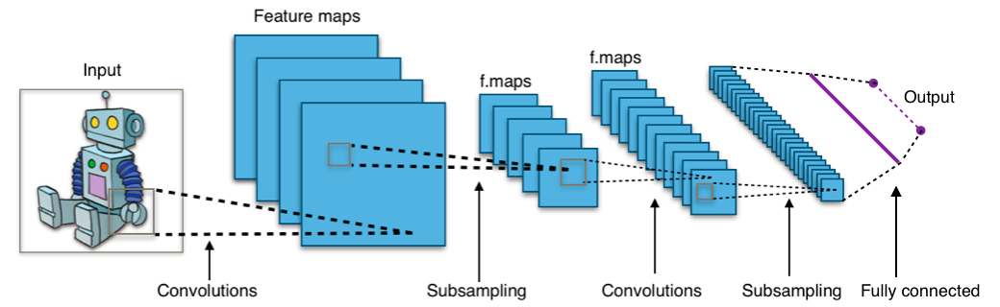
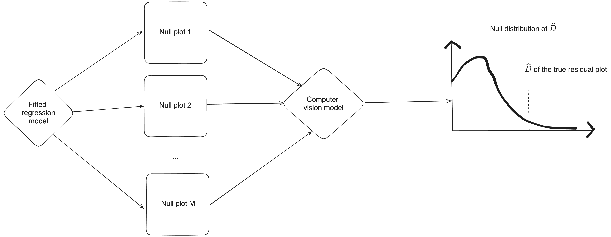

## Automated assessment of residual plots with computer vision models {.title-slide-title}

::: {.title-slide-event}

BASF Data Analytics (ML and AI) Community Meeting

:::

#### Patrick Li {.title-slide-author}

::: {.title-slide-org}

Australian National University

:::

---

## About me

Hi! I’m Patrick Li.

- **PhD in Statistics, Monash University (EBS)**  

  Developed computer vision methods to automate the assessment of regression diagnostic plots.

- **Postdoctoral Research Fellow, Australian National University (ANU)**  

  Contributing to the Analytics for the Australian Grains Industry (AAGI) project, applying machine learning and image analytics to plant phenotyping.

- **Current focus: [`torch-openreml`](https://github.com/anu-aagi/torch-openreml)** [`r fontawesome::fa_i("github")`](https://github.com/anu-aagi/torch-openreml)

  A PyTorch-based framework for flexible linear mixed-effects modelling using AI-REML estimation.


---


## ️Co-authors

```{r setup, include=FALSE}
knitr::opts_chunk$set(
  cache = FALSE,
  echo = FALSE,
  message = FALSE, 
  warning = FALSE
)

reticulate::use_condaenv("auto_residual_reading_paper")

library(tidyverse)
library(glue)
```

::: {.columns .text-75}

::: {.column width="25%"}

{style="object-fit: cover; width: 100%; aspect-ratio: 1 / 1;"}

**Prof Dianne Cook**

Department of Econometrics and Business Statistics, Melbourne, Monash University

:::

::: {.column width="25%"}

{style="object-fit: cover; width: 100%; aspect-ratio: 1 / 1;"}

**Dr Emi Tanaka**

Research School of Finance, Actuarial Studies and Statistics, Australian National University

:::


::: {.column width="25%"}

{style="object-fit: cover; width: 100%; aspect-ratio: 1 / 1;"}

**A/Prof Susan VanderPlas**

Department of Mathematics and Statistics, Utah State University

:::

::: {.column width="25%"}

{style="object-fit: cover; width: 100%; aspect-ratio: 1 / 1;"}

**A/Prof Klaus Ackermann**

Department of Econometrics and Business Statistics, Melbourne, Monash University, Australia

:::

:::

---

## Regression Diagnostics {visibility="hidden"}

::: {.callout-note appearance="minimal"}

::: {style="font-size: calc(var(--r-main-font-size));"}


Diagnostics are the key to determining whether there is anything **importantly wrong** with a regression model. 

$$\underbrace{\boldsymbol{e}}_\textrm{Residuals} = \underbrace{\boldsymbol{y}}_\textrm{Observations} - \underbrace{f(\boldsymbol{x})}_\textrm{Fitted values}$$

:::

:::

::: {.fragment}


**Graphical approaches (plots)** are informative tools for diagnosing residuals.


```{r fig.width=12, fig.height=4, fig.retina=3, warning=FALSE, message=FALSE, fig.align='center'}
library(tidyverse)
library(visage)
set.seed(452)

NEW_POLY_MODEL <- bandicoot::new_class(POLY_MODEL, class_name = "NEW_POLY_MODEL")
NEW_POLY_MODEL$set_formula(raw_z_formula = raw_z ~ hermite(shape)(((x + w) - min(x + w))/max((x + w) - min(x + w)) * 4 - 2),
                           null_formula = y ~ x + w,
                           formula = y ~ 1 + w + x + include_z * z + e)
bandicoot::register_method(NEW_POLY_MODEL, 
                           ..init.. = function (shape = 2, 
                                                sigma = 1, 
                                                include_z = TRUE, 
                                                x = visage::rand_uniform(-1, 1, new.env(parent = parent.env(self))), 
                                                w = visage::rand_uniform(-1, 1, new.env(parent = parent.env(self))), 
                                                e = visage::rand_normal(0,  sigma, new.env(parent = parent.env(self)))) {
    if (!shape %in% 1:4) 
          stop("Parameter `shape` out of range [1, 4].")
      hermite <- self$hermite
      raw_z <- visage::closed_form(eval(self$raw_z_formula), 
          env = new.env(parent = parent.env(self)))
      z <- visage::closed_form(eval(self$z_formula), env = new.env(parent = parent.env(self)))
      (bandicoot::use_method(self, visage::VI_MODEL$..init..))(prm = list(shape = shape, 
          include_z = include_z, sigma = sigma, x = x, w = w, raw_z = raw_z, 
          z = z, e = e), prm_type = list(shape = "o", include_z = "o", 
          sigma = "o", x = "r", w = "r", raw_z = "r", z = "r", e = "r"), 
          formula = self$formula, null_formula = self$null_formula, 
          alt_formula = self$alt_formula)
      return(invisible(self))
      })

mod <- NEW_POLY_MODEL$instantiate(sigma = 0.3)

ori_dat <- mod$gen(300)
p1 <- ori_dat %>%
  VI_MODEL$plot(theme = theme_light(base_size = 18), size = 1, remove_grid_line = TRUE) +
  xlab("Fitted values") +
  ylab("Residuals")

p2 <- ori_dat %>%
  ggplot() +
  geom_point(aes(x, .resid), size = 1) +
  theme_light(base_size = 18) + 
  ggplot2::theme(panel.grid.major = ggplot2::element_blank(), 
                 panel.grid.minor = ggplot2::element_blank()) +
  xlab(quote(x)) +
  ylab("Residuals")

p3 <- ori_dat %>%
  VI_MODEL$plot_qq() +
  theme_light(base_size = 18) + 
  ggplot2::theme(panel.grid.major = ggplot2::element_blank(), 
                 panel.grid.minor = ggplot2::element_blank()) +
  xlab("Theoretical") +
  ylab("Sample")

patchwork::wrap_plots(p1, p2, p3, ncol = 3)
```

:::

---


## Challenges in interpreting residual plots reliably {.nostretch}


::: {.column}

```{r fig.width=4.5, fig.height=4.5, fig.retina=3, warning=FALSE, message=FALSE, fig.align="right"}
library(tidyverse)
library(visage)
set.seed(452)
ori_x <- rand_lognormal()
mod <- heter_model(b = 0, x = closed_form(~-ori_x))
ori_dat <- mod$gen(300)

ori_dat %>%
  VI_MODEL$plot(theme = theme_light(base_size = 18), size = 1, remove_grid_line = TRUE) +
  xlab("Fitted values") +
  ylab("Residuals") +
  ggtitle(quote(y %~% x))
```

:::

::: {.column}


:::


---

## Challenges in interpreting residual plots reliably {.nostretch visibility="uncounted"}

::: {.column}

```{r fig.width=4.5, fig.height=4.5, fig.retina=3, warning=FALSE, message=FALSE, fig.align="right"}
library(tidyverse)
library(visage)
set.seed(452)
ori_x <- rand_lognormal()
mod <- heter_model(b = 0, x = closed_form(~-ori_x))
ori_dat <- mod$gen(300)

ori_dat %>%
  VI_MODEL$plot(theme = theme_light(base_size = 18), size = 1, remove_grid_line = TRUE) +
  annotate("segment", x = -12, y = 0, xend = 0, yend = -2.5, linetype = 2) +
  annotate("segment", x = -12, y = 0, xend = 0, yend = 2.5, linetype = 2) +
  xlab("Fitted values") +
  ylab("Residuals") +
  ggtitle(quote(y %~% x))
```

:::

::: {.column}

<br>
<br>
<br>

&nbsp;&nbsp;&nbsp;&nbsp;**Heteroskedasticity ?**

::: {.fragment .text-75}

&nbsp;&nbsp;&nbsp;&nbsp;&nbsp;&nbsp;Vertical spread of the points varies with the fitted values.

:::

:::

::: {.callout-note appearance="minimal" .fragment}

## However, this is an **over-interpretation**. 

The data are **simulated from the correctly specified model** $\boldsymbol{Y} = -\boldsymbol{X} + \boldsymbol{e}, \boldsymbol{e} \sim \mathcal{N} (\boldsymbol{0}, \boldsymbol{I})$.

The visual pattern is caused by a **skewed distribution of the predictor** $\ln \boldsymbol{X} \sim \mathcal{N}(\boldsymbol{0}, \boldsymbol{I})$.

:::


---

## How do we validate visual discoveries?


**Visual discoveries** that may appear to violate model assumptions:

::: {.incremental}

1. Random variation or sampling noise
2. Features of the predictors
3. Outliers
4. Plotting artifacts
5. **Genuine model-assumption violations**
6. ...

:::

---

## Traditional statistical testing


::: {.fragment .center-div}

Specify the null hypothesis $H_0$

:::

::: {.fragment .center-div}

↓  

Construct a test statistic $T(X)$

:::

::: {.fragment .center-div}

↓  

Derive the null distribution $F_0(t)$ under $H_0$

:::

::: {.fragment .center-div}

↓  

Compare the observed statistic $t_{\mathrm{obs}}$ with the null distribution.

:::

<br>

::: {.callout-note appearance="minimal" .fragment}

::: {style="font-size: calc(var(--r-main-font-size));"}

For an upper-tailed test, the $p$-value under $H_0$ is $P\big(T(X) \geq t_{\mathrm{obs}}\big)$.

**Decision:** Reject $H_0$ if $p \leq \alpha$.

:::

:::

---

## Visual inference (Buja, et al. 2009)


::: {.column}

```{r fig.width=7, fig.height=7, fig.retina=3}
set.seed(452)
mod$gen_lineup(300, k = 20, pos = 11) %>%
  filter(null != FALSE) %>%
  bind_rows(ori_dat %>% mutate(k = 11, null = FALSE)) %>%
  VI_MODEL$plot_lineup(theme = theme_light(base_size = 12),
                       remove_grid_line = TRUE,
                       remove_axis = TRUE)
```

:::


::: {.column width="50%"}

::: {.incremental}


1. $H_0$: The linear regression model satisfies all model assumptions.

2. $T(X)$: The residual v.s. fitted plot.

3. $F_0(t)$: **Simulate residuals from the fitted regression model** (details on the next slide) to generate a collection of **null plots**.

4. Randomly place the observed plot, $t_{\mathrm{obs}}$, among 19 null plots to form a **lineup**. Ask $N$ observers to identify the **most different plot(s)**.

:::

::: {.fragment .text-75}

$$
p = P(K \geq k) = \sum_{j=k}^{N} \binom{N}{j}
\left(\frac{1}{20}\right)^j
\left(1-\frac{1}{20}\right)^{N-j}.
$$

:::

:::


---

## Null residuals simulation (Buja, et al. 2009)

::: {.callout-note appearance="minimal"}

::: {style="font-size: calc(var(--r-main-font-size));"}

For a classical normal linear regression model: &nbsp;&nbsp;&nbsp;&nbsp;&nbsp;&nbsp;&nbsp;&nbsp;&nbsp;&nbsp;&nbsp;&nbsp;&nbsp;&nbsp;&nbsp;&nbsp;&nbsp;&nbsp;&nbsp;&nbsp;&nbsp;&nbsp;&nbsp;&nbsp;&nbsp;&nbsp;&nbsp;&nbsp;&nbsp;&nbsp;&nbsp;&nbsp;&nbsp;&nbsp;&nbsp;&nbsp;&nbsp;&nbsp;&nbsp;&nbsp;&nbsp;&nbsp;&nbsp;&nbsp;&nbsp;&nbsp;&nbsp;&nbsp;&nbsp;&nbsp;&nbsp;&nbsp;&nbsp;&nbsp;&nbsp;&nbsp;&nbsp;&nbsp;&nbsp;&nbsp;&nbsp;&nbsp;&nbsp;&nbsp;&nbsp;&nbsp;&nbsp;&nbsp;&nbsp;&nbsp;&nbsp;&nbsp;&nbsp;&nbsp;&nbsp;&nbsp;&nbsp;&nbsp;&nbsp;&nbsp;&nbsp;&nbsp;&nbsp;&nbsp;&nbsp;&nbsp;&nbsp;&nbsp;&nbsp;&nbsp;&nbsp;&nbsp;&nbsp;&nbsp;&nbsp;&nbsp;&nbsp;

$$\hat{\boldsymbol{\beta}} = (\boldsymbol{X}^\top\boldsymbol{X})^{-1}\boldsymbol{X}^\top\boldsymbol{y},\quad \hat{\sigma}^2 = \frac{(\boldsymbol{y} - \boldsymbol{X}\boldsymbol{\beta})'(\boldsymbol{y} - \boldsymbol{X}\boldsymbol{\beta})}{n-p}.$$
:::


:::

1. Simulate $\tilde{\boldsymbol{e}} \sim N(\boldsymbol{0}, \hat{\sigma}^2\boldsymbol{I})$

2. Obtain $\tilde{\boldsymbol{y}} = \boldsymbol{X}\hat{\boldsymbol{\beta}} + \tilde{\boldsymbol{e}}$

3. Estimate $\tilde{\boldsymbol{\beta}} = (\boldsymbol{X}^\top\boldsymbol{X})^{-1}\boldsymbol{X}^\top\tilde{\boldsymbol{y}}$

4. Obtain $\boldsymbol{e}_{null} =  \tilde{\boldsymbol{y}} - \boldsymbol{X}\tilde{\boldsymbol{\beta}}, \quad\hat{\boldsymbol{y}}_{null} = \boldsymbol{X}\tilde{\boldsymbol{\beta}}$

---

## Characteristics of the lineup protocol

✅

* **All-in-one test**: can detect many visually recognisable violations

* **Validated visual findings**: helps identify which visual patterns are truly meaningful and may guide model refinement.

::: {.fragment}

❌

* **Human constraints**:

  * hard to evaluate many lineups
  * hard to process lineups with many plots
* **Resource-intensive**: high labour cost and time-consuming

:::

<br>

::: {.fragment}

### Can we automate it?

:::

---

## Computer vision model

Modern **computer vision models** are well-suited for addressing this challenge. 



---

## To compare observed plot and null plots

<br>

### How do we define a **numerical measure** of **"difference"** or **"distance"** between residual plots?

::: {.column width="50%"}

<br>

- pixel-wise sum of square differences?
- Structural Similarity Index Measure (SSIM)?
- scagnostics?
- ...

:::

::: {.column width="50%"}

<br>

::: {.column width="30%"}

```{r fig.width=2.5, fig.height=2.5, fig.retina=3, warning=FALSE, message=FALSE, fig.align='center'}
set.seed(452)
mod <- poly_model()
ori_dat <- mod$gen(300)

ori_dat %>%
  VI_MODEL$plot(theme = theme_light(base_size = 18), size = 1, remove_grid_line = TRUE, remove_axis = TRUE)
```

:::

::: {.column width="10%" .center-div}

<br>

$-$

:::

::: {.column width="30%"}

```{r fig.width=2.5, fig.height=2.5, fig.retina=3, warning=FALSE, message=FALSE, fig.align='center'}
set.seed(452)
mod <- poly_model()
ori_dat <- mod$gen_lineup(300, k = 2) |>
  filter(null == TRUE)

ori_dat %>%
  VI_MODEL$plot(theme = theme_light(base_size = 18), size = 1, remove_grid_line = TRUE, remove_axis = TRUE)
```

:::

::: {.column width="10%" .center-div}

<br>

$=$

:::

::: {.column width="10%" .center-div}

<br>

$?$

:::

:::

---

## Reference and actual residual distribution

Under $H_0$, the residuals are given by

$$\hat{\boldsymbol{e}} = \left[ \boldsymbol{I} - \boldsymbol{X}(\boldsymbol{X}^\top\boldsymbol{X})^{-1} \boldsymbol{X}^\top \right]\boldsymbol{e}, \quad \boldsymbol{e} \sim \mathcal{N}(\boldsymbol{0}, \sigma^2\boldsymbol{I}).$$

Let $P$ denote the **reference residual distribution** of $\hat{\boldsymbol{e}}$.

::: {.fragment}

If $H_0$ does not hold but the data-generating process for $\boldsymbol{Y}$ is known, we can similarly derive the **actual residual distribution** of

$$
\hat{\boldsymbol{e}} =
\left[
\boldsymbol{I} -
\boldsymbol{X}(\boldsymbol{X}^\top\boldsymbol{X})^{-1}
\boldsymbol{X}^\top
\right]\boldsymbol{Y},
$$

denoted by $Q$.

:::

---

## Distance from "theoretically" good residual plots

::: {.callout-note appearance="minimal"}


We defined a **distance measure** based on **Kullback-Leibler divergence** to quantify the **extent of model violations:**

$$D = \log\left(1 + \int_{\mathbb{R}^{n}}\log\frac{p(\boldsymbol{e})}{q(\boldsymbol{e})}p(\boldsymbol{e})d\boldsymbol{e}\right).$$

:::

::: {.column width="45%"}

```{r fig.width=8, fig.height=2, fig.retina=3, warning=FALSE, message=FALSE, fig.align='center'}
set.seed(452)
mod <- poly_model()
p <- list()

for (i in 1:4) {
  ori_dat <- mod$gen(300)

  p[[i]] <- ori_dat %>%
    VI_MODEL$plot(theme = theme_light(base_size = 18), size = 1, remove_grid_line = TRUE, remove_axis = TRUE)
}

patchwork::wrap_plots(p, nrow = 1) +
  patchwork::plot_annotation(title = "Samples from the actual residual distribution Q")
```
:::


::: {.column width="10%"}

:::

::: {.column width="45%"}

```{r fig.width=8, fig.height=2, fig.retina=3, warning=FALSE, message=FALSE, fig.align='center'}
set.seed(452)
mod <- poly_model()
p <- list()

for (i in 1:4) {
  ori_dat <- mod$gen_lineup(300, k = 2) |>
    filter(null == TRUE)

  p[[i]] <- ori_dat %>%
    VI_MODEL$plot(theme = theme_light(base_size = 18), size = 1, remove_grid_line = TRUE, remove_axis = TRUE)
}

patchwork::wrap_plots(p, nrow = 1) +
  patchwork::plot_annotation(title = "Samples from the reference residual distribution P")
```

:::

::: {.column width="45%" .center-div}
$$Q$$

:::

::: {.column width="10%"  .center-div}

$$\overset{D}{\longrightarrow}$$

:::

::: {.column width="45%"  .center-div}
$$P$$

:::

::: {.fragment .text-80}

### [However, $Q$ is unknown in practice $\Rightarrow$ $D$ can not be computed.]{.underline}

:::

---

## Simulation of training data 

::: {.callout-note appearance="minimal"}

::: {style="font-size: calc(var(--r-main-font-size));"}

In a simulation, we can control the data-generating process and therefore know the actual residual distribution $Q$.


:::

:::


::: {.columns}

::: {.column width="30%"}

**Non-linearity + Heteroskedasticity**

:::

::: {.column width="70%"}


```{r fig.width=12, fig.height=2}
set.seed(10086)

# Data for shape 1
model <- phn_model(j = 2, a = 1, b = 100, include_x2 = FALSE, sigma = 0.05)
dat_shape_1 <- model$gen(500) %>%
  mutate(j = 2) %>%
  {mutate(., d = log(model$sample_effect_size(.) + 1))} %>%
    mutate(label_x = min(.fitted) + (max(.fitted) - min(.fitted)) * 0.5, 
           label_y = max(.resid) * 0.9)

# Generate data for shape 2, 3 and 4. Reuse x and e.
map_df(c(3, 5, 9, 11), function(j) {
  model <- phn_model(j = j, a = (-1)^j, b = 100, include_x2 = FALSE, sigma = 0.05)
  model$gen(500, computed = select(dat_shape_1, x1, e)) %>%
    mutate(j = j) %>%
    {mutate(., d = log(model$sample_effect_size(.) + 1))} %>%
    mutate(label_x = min(.fitted) + (max(.fitted) - min(.fitted)) * 0.5, 
           label_y = max(.resid) * 0.9)
}) %>%
  
  # Combined with data for shape 1
  bind_rows(dat_shape_1) %>%
  mutate(j = factor(j)) %>%
  VI_MODEL$plot(remove_axis = TRUE, remove_grid_line = TRUE, theme = theme_light(base_size = 15)) +
  geom_text(aes(x = label_x, y = label_y, label = glue::glue("D = {round(d, 2)}"))) +
  facet_wrap(~j, scales = "free", labeller = label_parsed, ncol = 5)
```

:::

:::


::: {.columns}

::: {.column width="30%"}

**Non-normality + Heteroskedasticity**

:::

::: {.column width="70%"}


```{r fig.width=8, fig.height=2}
set.seed(10085)

# Data for shape 1
model <- phn_model(a = -1, b = 100, include_z = FALSE, include_x2 = FALSE, e = rand_uniform(-1.4, 1.4))
dat_shape_1 <- model$gen(500) %>%
  mutate(e_dist = "uniform") %>%
  {mutate(., d = log(model$sample_effect_size(.) + 1))} %>%
  mutate(label_x = min(.fitted) + (max(.fitted) - min(.fitted)) * 0.5, 
         label_y = max(.resid) * 0.9)

model <- phn_model(a = -1, b = 100, include_z = FALSE, include_x2 = FALSE, sigma = 0.8)
dat_shape_2 <- model$gen(500) %>%
  mutate(e_dist = "normal") %>%
  {mutate(., d = log(model$sample_effect_size(.) + 1))} %>%
  mutate(label_x = min(.fitted) + (max(.fitted) - min(.fitted)) * 0.5, 
         label_y = max(.resid) * 0.9)

model <- phn_model(a = -1, b = 100, include_z = FALSE, include_x2 = FALSE, e = rand_lognormal(sigma = 0.6))
dat_shape_3 <- model$gen(500) %>%
  mutate(e_dist = "lognormal") %>%
  {mutate(., d = log(model$sample_effect_size(.) + 1))} %>%
  mutate(label_x = min(.fitted) + (max(.fitted) - min(.fitted)) * 0.5, 
         label_y = max(.resid) * 0.9)

model <- phn_model(a = -1, b = 100, include_z = FALSE, include_x2 = FALSE, e = rand_uniform_d(-1.4, 1.4, even = TRUE))
dat_shape_4 <- model$gen(500) %>%
  mutate(e_dist = "discrete") %>%
  {mutate(., d = log(model$sample_effect_size(.) + 1))} %>%
  mutate(label_x = min(.fitted) + (max(.fitted) - min(.fitted)) * 0.5, 
         label_y = max(.resid) * 0.9)

# Generate data for shape 2, 3 and 4. Reuse x and e.
bind_rows(dat_shape_1, dat_shape_2, dat_shape_3, dat_shape_4) %>%
  VI_MODEL$plot(remove_axis = TRUE, remove_grid_line = TRUE, theme = theme_light(base_size = 15)) +
  geom_text(aes(x = label_x, y = label_y, label = glue::glue("D = {round(d, 2)}"))) +
  facet_wrap(~e_dist, scales = "free", labeller = label_parsed, ncol = 4)
```

:::

:::


::: {.columns}

::: {.column width="30%"}

**Distribution of predictor**

:::

::: {.column width="70%"}


```{r fig.width=8, fig.height=2}
set.seed(10086)

stand_dist <- function(x) (x - min(x))/max(x - min(x)) * 2 - 1

# Data for uniform distribution
model <- poly_model(shape = 1, 
                      x = {
                        raw_x <- rand_uniform(-1, 1);
                        closed_form(~stand_dist(raw_x))
                        }, 
                      sigma = 0.5)
dat_dist_1 <- model$gen(300) %>%
  mutate(x_dist = "uniform") %>%
  {mutate(., d = log(model$sample_effect_size(.) + 1))} %>%
  mutate(label_x = min(.fitted) + (max(.fitted) - min(.fitted)) * 0.5, 
         label_y = max(.resid) * 0.9)

# Generate data for other distributions
model <- poly_model(shape = 1,
                         x = {
                           raw_x <- rand_normal(sigma = 0.3); 
                           closed_form(~stand_dist(raw_x))
                           }, 
                         sigma = 0.5)
dat_dist_2 <- model$
  gen(300, computed = select(dat_dist_1, e)) %>%
  mutate(x_dist = "normal") %>%
  {mutate(., d = log(model$sample_effect_size(.) + 1))} %>%
  mutate(label_x = min(.fitted) + (max(.fitted) - min(.fitted)) * 0.5, 
         label_y = max(.resid) * 0.9)

model <- poly_model(shape = 1,
                         x = {
                           raw_x <- rand_lognormal(sigma = 0.6); 
                           closed_form(~stand_dist(raw_x/3 - 1))
                           }, 
                         sigma = 0.5)
dat_dist_3 <- model$
  gen(300, computed = select(dat_dist_1, e)) %>%
  mutate(x_dist = "lognormal") %>%
  {mutate(., d = log(model$sample_effect_size(.) + 1))} %>%
  mutate(label_x = min(.fitted) + (max(.fitted) - min(.fitted)) * 0.5, 
         label_y = max(.resid) * 0.9)

model <- poly_model(shape = 1,
                         x = {
                           raw_x <- rand_uniform_d(k = 5, even = TRUE); 
                           closed_form(~stand_dist(raw_x))
                           }, 
                         sigma = 0.5)
dat_dist_4 <- model$
  gen(300, computed = select(dat_dist_1, e)) %>%
  mutate(x_dist = "discrete") %>%
  {mutate(., d = log(model$sample_effect_size(.) + 1))} %>%
  mutate(label_x = min(.fitted) + (max(.fitted) - min(.fitted)) * 0.5, 
         label_y = max(.resid) * 0.9)

# Generate and plot data for discrete uniform distribution
bind_rows(dat_dist_1, dat_dist_2, dat_dist_3, dat_dist_4) %>%
  mutate(x_dist = factor(x_dist, 
                         levels = c("discrete", 
                                    "lognormal", 
                                    "normal", 
                                    "uniform"))) %>%
  VI_MODEL$plot(remove_axis = TRUE, remove_grid_line = TRUE, theme = theme_light(base_size = 15)) +
  geom_text(aes(x = label_x, y = label_y, label = glue::glue("D = {round(d, 2)}"))) +
  xlab("Fitted values") +
  ylab("Residuals") +
  facet_wrap(~x_dist, ncol = 4, scales = "free")
```

:::

:::

---


## Estimation of $D$


We train a **computer vision model** to estimate $D$ with **64,000 simulated residual plots**:


$$\widehat{D} = f_{CV}(V_{h \times w}(\boldsymbol{e}, \boldsymbol{\hat{y}})),$$

where $V_{h \times w}(.)$ generates an $h \times w$ image, and  $f_{CV}(.)$ predicts a non-negative distance.


```{r fig.align='center', out.width='85%'}
magick::image_read_pdf("figures/cnn.pdf", pages = 1)
```


---

## Statistical testing

::: {.callout-note appearance="minimal"}

::: {style="font-size: calc(var(--r-main-font-size));"}


The **$p$-value** is the proportion of null plots having $\widehat{D}$ **greater than or equal to** the observed one.

:::

:::



---

## `r fontawesome::fa_i("r-project")` `autovi` Package

::: {.callout-note appearance="minimal"}

::: {style="font-size: calc(var(--r-main-font-size));"}


Li, W., Cook, D., Tanaka, E., VanderPlas, S., & Ackermann, K. (2025). Automated Residual Plot Assessment With the R Package autovi and the Shiny Application autovi. web. Australian & New Zealand Journal of Statistics.

:::

:::


<br>

### Core Methods

- Null residuals simulation: `rotate_resid()`
- Visual signal strength ($\widehat{D}$ prediction): `vss()`
- Comprehensive checks: `check()` and `summary_plot()`


---


## Example: Boston housing {.nostretch}


```{r}
housing <- read_csv(here::here("data/housing.csv"))
```

```r
library(autovi)
fitted_model <- lm(MEDV ~ RM + LSTAT + PTRATIO, data = housing)
checker <- residual_checker(fitted_model)
checker$plot_resid()
```

```{r}
#| echo: false
#| fig-height: 5
#| fig-width: 5
#| fig-align: center
fitted_model <- lm(MEDV ~ RM + LSTAT + PTRATIO, data = housing)
tibble(.fitted = fitted(fitted_model),
       .resid = resid(fitted_model)) %>%
  VI_MODEL$plot(theme = theme_light(base_size = 18), size = 1, remove_grid_line = TRUE, remove_axis = TRUE)
```


```{r}
#| echo: false
#| message: false
library(autovi)
checker <- auto_vi(fitted_model = fitted_model, 
                   keras_model = get_keras_model("vss_phn_32"))
checker$check_result <- readRDS(here::here("data/check_result_1.rds"))
```

---


## `r fontawesome::fa_i("r-project")` `rotate_resid()`


Null residuals are simulated from the fitted model assuming it is **correctly specified**.

::: {.columns}

::: {.column width="50%"}

```{.r}
checker$rotate_resid()
```

```{r}
#| echo: false
#| message: false
checker$rotate_resid()
```

:::

::: {.column width="50%"}

```{.r}
checker$rotate_resid() |>
  checker$plot_resid()
```


```{r}
#| echo: false
#| message: false
#| fig-height: 5
#| fig-width: 5
#| fig-align: center
checker$rotate_resid() |>
  VI_MODEL$plot(theme = theme_light(base_size = 18), size = 1, remove_grid_line = TRUE, remove_axis = TRUE)
```

:::

:::

---


## `r fontawesome::fa_i("r-project")` `vss()`


::: {.columns}

::: {.column width="50%"}

#### Visual signal strength $\widehat{D}$ of the actual residual plot

```{.r}
checker$vss()
```

```{r}
#| echo: false
#| message: true
checker$vss()
```

:::

::: {.column width="50%"}

#### Visual signal strength $\widehat{D}$ of a null plot

```{.r}
checker$rotate_resid() |>
  checker$vss()
```


```{r}
#| echo: false
#| message: true
checker$rotate_resid() |>
  checker$vss()
```


:::

:::

---


## `r fontawesome::fa_i("r-project")` `check()` and `summary_plot()`

::: {.columns}

::: {.column}

```{.r}
checker$check()
```

```{r}
#| echo: false
#| message: true
checker
```

:::

::: {.column}

```r
checker$summary_plot()
```

```{r}
#| echo: false
#| fig-width: 4.5
#| fig-height: 4.5
#| dpi: 300
checker$summary_plot() +
  theme(legend.position = "bottom", legend.box="vertical") +
  labs(linetype = "")
  
```


:::

:::

---


## Example: Left-triangle

::: {.columns}

::: {.column}

Breusch–Pagan test $p$-value = 0.0457


```{r fig.height=5, fig.width=5, fig.align='center'}
set.seed(452)
ori_x <- rand_lognormal()
dat <- heter_model(b = 0, x = closed_form(~-ori_x))$gen(300)

mod <- lm(y ~ x, data = dat)
my_vi <- autovi::auto_vi(fitted_model = mod)
my_vi$get_fitted_and_resid() |>
  VI_MODEL$plot(theme = theme_light(base_size = 18), size = 1, remove_grid_line = TRUE, remove_axis = TRUE)
```

:::

::: {.column}

```{r fig.height=4.5, fig.width=4.5, dpi=300}
my_vi$check_result <- readRDS(here::here("data/fig1_check.rds"))
my_vi$summary_plot() +
  theme(legend.position = "bottom", legend.box="vertical") +
  labs(linetype = "")
```

:::

:::


---


## 💡Example: Dinosaur


::: {.columns}

::: {.column width="50%"}

Ramsey Regression Equation Specification Error test $p$-value = 0.742

Breusch–Pagan test $p$-value = 0.36

Shapiro-Wilk test $p$-value = 9.21e-05

```{r fig.height=5, fig.width=5, fig.align='center'}
dino <- datasauRus::datasaurus_dozen %>% filter(dataset == "dino")
mod <- lm(y ~ ., data = select(dino, -dataset))

my_vi <- autovi::auto_vi(fitted_model = mod)
my_vi$get_fitted_and_resid() |>
  VI_MODEL$plot(theme = theme_light(base_size = 18), size = 1, remove_grid_line = TRUE, remove_axis = TRUE)
```

:::

::: {.column width="50%"}

```{r fig.height=4.5, fig.width=4.5, dpi=300}
my_vi$check_result <- readRDS(here::here("data/dino_check.rds"))
my_vi$summary_plot() +
  theme(legend.position = "bottom", legend.box="vertical") +
  labs(linetype = "")
```

:::

:::

---

## 🌐Shiny Application {.center}

Don't want to install `TensorFlow`? 

Try our shiny web application: <http://autovi.patrickli.org/>


---

## Takeaway

- Use lineup-based tests to validate visual discoveries.

With `autovi`, you can:

- Evaluate lineups of residual plots from linear regression models.
- **Quantify the strength of model violations** using visual signal strength.
- **Automatically detect model misspecification** using a visual test.

Extensions to GLM and LMM frameworks are ongoing research.

---


## Thanks! Any questions? {.center}


::: {.nonincremental}

::: {.callout-note appearance="minimal"}

## References

Li, W., Cook, D., Tanaka, E., VanderPlas, S., & Ackermann, K. (2026). Automated residual plot assessment with the R package autovi and the Shiny application autovi. web. Australian & New Zealand Journal of Statistics, 68(1), e70027.

Li, W., Cook, D., Tanaka, E., VanderPlas, S., & Ackermann, K. (2024). Automated Assessment of Residual Plots with Computer Vision Models. arXiv preprint arXiv:2411.01001.

Buja, A., Cook, D., Hofmann, H., Lawrence, M., Lee, E. K., Swayne, D. F., & Wickham, H. (2009). Statistical inference for exploratory data analysis and model diagnostics. Philosophical Transactions of the Royal Society A: Mathematical, Physical and Engineering Sciences, 367(1906), 4361-4383.

:::

:::


<br>

::: {.nonincremental}

`r fontawesome::fa_i("github")` [tengmcing](https://github.com/TengMCing)

`r fontawesome::fa_i("envelope")` [patrick.li@anu.edu.au](mailto:patrick.li@anu.edu.au)

📦 [https://github.com/TengMCing/autovi](https://github.com/TengMCing/autovi){target="_blank"}

📜 [https://github.com/TengMCing/basf2026-autovi](https://github.com/TengMCing/basf2026-autovi){target="_blank"}


:::


